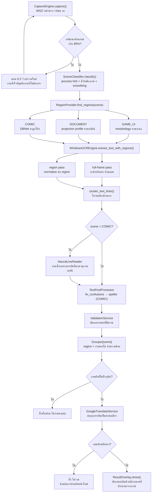
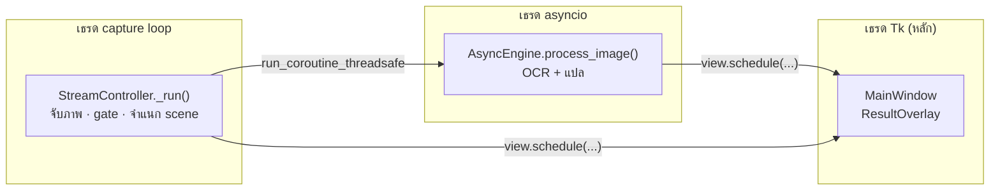
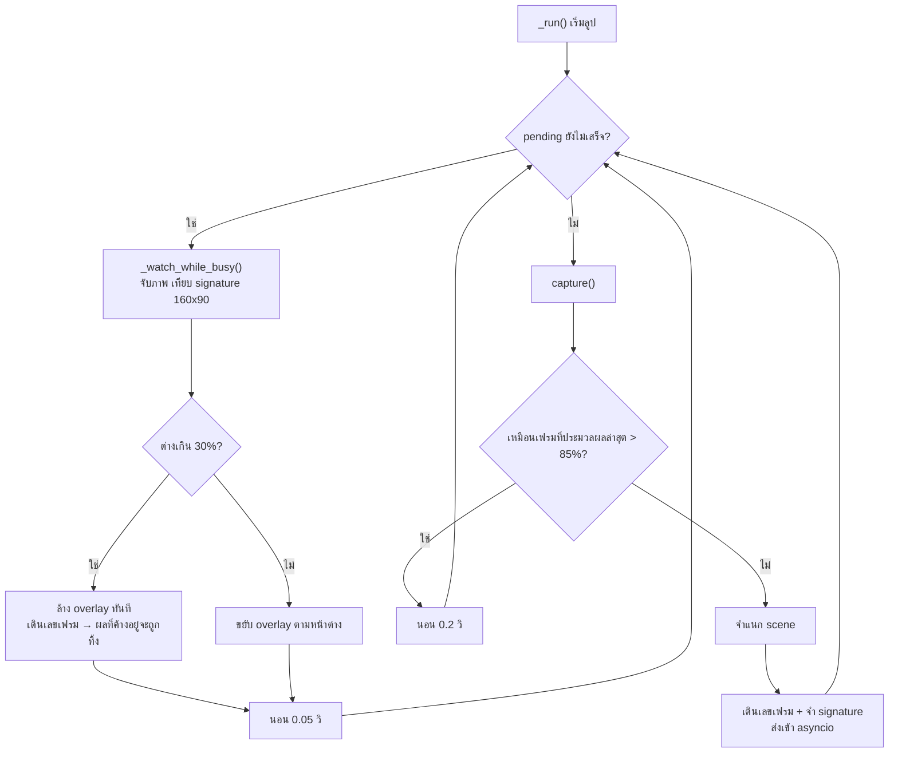
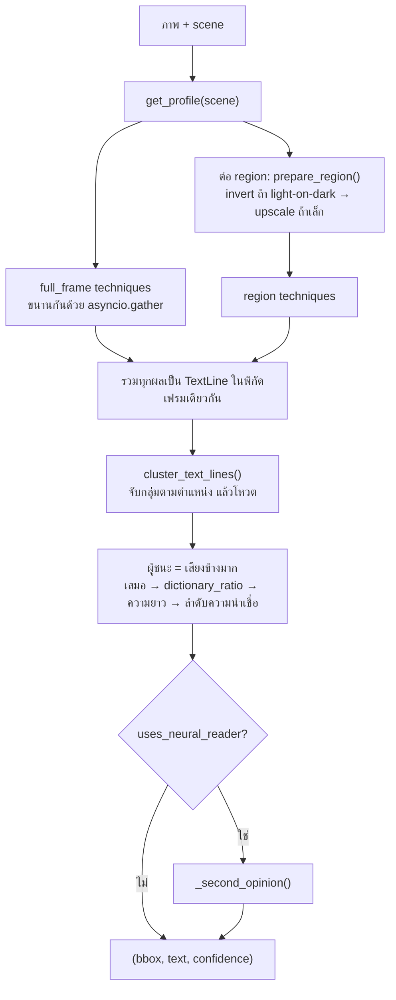
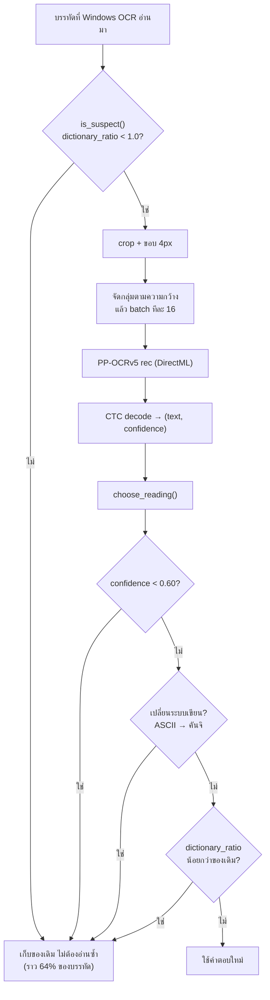
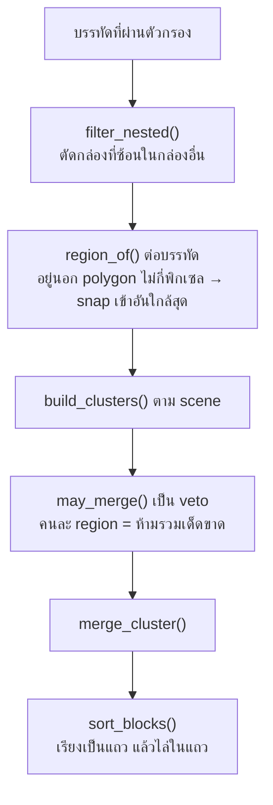
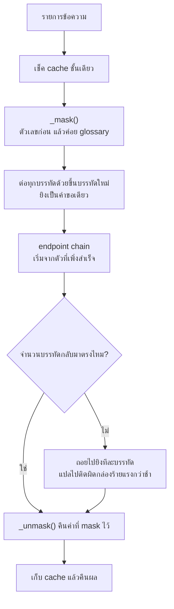

# Overlayr — โครงสร้างโปรแกรมและเส้นทางของข้อมูล

อัปเดต 2026-09-02 · ตรงกับโค้ดหลัง Phase 7

เอกสารนี้ตอบว่า **ไฟล์ไหนทำอะไร และข้อมูลเดินทางอย่างไร**
ส่วน **ทำไมถึงเลือกทำแบบนั้น** อยู่ใน `CLAUDE.md` — ถ้าจะแก้โค้ด ต้องอ่านไฟล์นั้นด้วย

---

## 1. ภาพรวม — หนึ่งเฟรมเดินทางอย่างไร



**จุดที่ต้องเข้าใจสามข้อ**

1. **มีประตูสามบานที่ทิ้งงานทิ้งได้** — similarity gate (ก่อนเริ่ม), staleness check (ก่อนแปล),
   generation counter (ก่อนวาด) ทั้งสามมีไว้เพราะไปป์ไลน์ใช้เวลาราว 2 วินาที
   ซึ่งนานพอที่หน้าจอจะเปลี่ยนไปแล้ว
2. **`scene` เป็นตัวเลือกพฤติกรรมของทุกขั้นถัดจากนั้น** ไม่ใช่ setting ที่ผู้ใช้ต้องตั้ง
3. **full-frame pass อยู่คู่กับ region pass เสมอ** ไม่ใช่ทางเลือกแทนกัน

---

## 2. สามเธรด



| เธรด | สร้างที่ไหน | กฎ |
|---|---|---|
| **Tk main** | `main.py` | ทุกอย่างที่แตะ widget ต้องผ่าน `view.schedule` เท่านั้น |
| **capture loop** | `StreamController.start()` | เป็น**ผู้เรียก `capture()` รายเดียว** — WGC frame pool ออกแบบให้ drain ไม่ใช่แชร์ |
| **asyncio** | `main_window._run_async_loop` | `run_forever` รับงานผ่าน `run_coroutine_threadsafe` |

`CaptureEngine`, `AsyncEngine`, `WindowsOCREngine` เป็น singleton (`utils/singleton.py`)

---

## 3. ไฟล์ทั้งหมด

### `core/` — ไปป์ไลน์ สถานะ และการจับภาพ

| ไฟล์ | บรรทัด | หน้าที่ |
|---|---|---|
| `wgc_capture.py` | 1193 | Windows Graphics Capture ผ่าน ctypes ล้วน จับหน้าต่างที่ถูกบังได้ **drain frame pool** เพื่อเอาเฟรมล่าสุดเสมอ |
| `grouper.py` | 456 | รวมบรรทัดเป็นบล็อก หนึ่งคลาสต่อ scene + region veto + ลำดับการอ่าน |
| `stream_controller.py` | 359 | ลูป capture→แปล→วาด · similarity gate · staleness · generation counter |
| `post_processing.py` | 343 | `clean_text` → `fix_confusions` → SymSpell (เฉพาะ COMIC) |
| `engine.py` | 243 | ร้อย OCR → post-process → filter → group → แปล เข้าด้วยกัน |
| `capture_engine.py` | 194 | สลับ WGC/mss · ROI · คืน bounds ให้ overlay วางตำแหน่ง |
| `block_colors.py` | 188 | ประมาณสีกระดาษ/สีหมึกในกล่อง (Otsu + ฐานนิยม) |
| `overlay_render.py` | 138 | กฎการจัดวางตัวอักษร ใช้ร่วมกันระหว่าง Tk overlay กับตัวเรนเดอร์ของ harness |
| `scene.py` | 87 | `SceneType` enum + แมปไป merge mode / speller / ป้ายใน UI |

### `services/` — ตัวห่อของนอก

| ไฟล์ | บรรทัด | หน้าที่ |
|---|---|---|
| `windows_ocr.py` | 1250 | region-first OCR · เทคนิคขนาน · consensus vote · clustering · เรียกผู้อ่านที่สอง |
| `ocr_preprocessor.py` | 781 | เตรียมภาพ + DBNet (`DBNET_MODELS` จับคู่โมเดลกับ threshold ของมันเอง) |
| `google_translate.py` | 413 | endpoint chain · session เดียว · cache ชั้นเดียว · placeholder guard · glossary |
| `region_provider.py` | 311 | หา region ต่อ scene · `Region` มี polygon ไม่ใช่แค่กล่อง |
| `neural_ocr.py` | 285 | ผู้อ่านที่สอง (PP-OCRv5) + กฎตัดสินว่าคำตอบไหนชนะ |
| `scene_classifier.py` | 260 | จำแนก scene · smoothing · manual override |
| `source_manager.py` | 194 | รายชื่อหน้าต่าง/จอ พร้อมชื่อโปรเซสที่ classifier ใช้เป็น hint |
| `ocr_profile.py` | 161 | ตารางว่า scene ไหนใช้เทคนิคอะไร **ทุกค่ามาจาก harness** |
| `validation_service.py` | 141 | กรองข้อความแบบอนุรักษ์นิยม |
| `lexicon.py` | 87 | `dictionary_ratio` — ตัวตัดสินเวลาสองผู้อ่านไม่ตรงกัน |
| `auth_service.py` | 286 | Firebase login / session / deep link |
| `config_service.py` | 49 | อ่าน/เขียน `settings.json` |

### `ui/`

| ไฟล์ | บรรทัด | หน้าที่ |
|---|---|---|
| `main_window.py` | 1133 | หน้าต่างควบคุม · เลือก source · dropdown ภาษา/Mode/Overlay · สร้างสามเธรด |
| `components/settings_screen.py` | 459 | หน้าตั้งค่า |
| `overlay.py` | 333 | หน้าต่างโปร่งใสที่วาดคำแปล click-through |
| `theme.py` | 84 | ธีมมืด/สว่าง |
| `components/` | 227 | `source_card` · `loading_spinner` · `settings_dialog` |

### `eval/` — เครื่องมือวัดคุณภาพ

| ไฟล์ | บรรทัด | หน้าที่ |
|---|---|---|
| `runner.py` | 437 | รัน 4 stage: `ocr` / `pipeline` / `overlay` · เทียบ baseline · เขียน JSON |
| `dataset.py` | 220 | อ่านภาพ + `_Answer.txt` · บรรทัดว่างในไฟล์ = เส้นแบ่งกลุ่ม |
| `metrics.py` | 217 | `line_recall` · `word_recall` · `group_separation` · `cer` |
| `overlay_stage.py` | 118 | วาดคำแปลลงภาพแล้ว OCR ซ้ำ เพื่อวัด `cover` |

### `utils/`

| ไฟล์ | บรรทัด | หน้าที่ |
|---|---|---|
| `image_utils.py` | 91 | `calculate_similarity` (gate) · `frame_signature` (staleness ราคาถูก) |
| `single_instance.py` | 81 | named pipe กันเปิดโปรแกรมซ้อน (ใช้ `win32pipe`/`win32file`) |
| `console.py` | 30 | ตั้ง `errors="replace"` ให้ stdout — ไม่งั้น `print` ภาษาไทย/ญี่ปุ่นทำให้ไปป์ไลน์ตาย |
| `singleton.py` | 18 | `SingletonMeta` |

---

## 4. รายละเอียดต่อขั้น

### 4.1 จับภาพและกรองเฟรม — `stream_controller.py`



**เกณฑ์สองระดับ ไม่ใช่ค่าเดียว**

| ค่า | ตอบคำถามอะไร |
|---|---|
| `SIMILARITY_SKIP_PERCENT = 85` | "ควรเริ่มงานใหม่ไหม" |
| `STALE_SIMILARITY_PERCENT = 70` | "งานที่ทำไปแล้วยังควรแสดงไหม" |

ค่าหลังผ่อนกว่าโดยตั้งใจ — ทิ้งคำแปลที่ดีเพราะเคอร์เซอร์กะพริบ แย่กว่าความไม่สดที่มันป้องกัน

### 4.2 จำแนก scene — `scene_classifier.py`

รวมสัญญาณจากถูกที่สุดไปแพงที่สุด แล้วถ่วงน้ำหนัก

| สัญญาณ | ที่มา |
|---|---|
| ชื่อโปรเซส + ชื่อหน้าต่าง | `SourceManager` มีอยู่แล้ว ไม่ต้องคำนวณเพิ่ม |
| saturation · สัดส่วนพิกเซลขาว · เส้นตรงยาว · ความเป็นคาบของ projection | คำนวณจากภาพ |
| majority vote ย้อนหลัง ~10 เฟรม | กันไม่ให้สลับประเภทรายเฟรม |

`_last` ตั้งต้นเป็น `GAME_UI` และ `current` **ไม่เคยคืน `None`** — โปรไฟล์ LEGACY จึงเข้าถึงได้
เฉพาะจาก harness แบบ `--legacy` เท่านั้น

ผู้ใช้ล็อกเองได้จาก dropdown `Mode` (`Auto / Game / Document / Comic`) → `settings.json` คีย์ `scene_type`

### 4.3 หา region — `region_provider.py`

| scene | วิธี | ได้อะไร |
|---|---|---|
| GAME_UI | morphological gradient → close แนวนอน → close เป็นพาเนล | กล่องพาเนล |
| DOCUMENT | vertical projection profile หาหุบเขาช่องว่าง | แถบคอลัมน์ |
| COMIC | DBNet ONNX | **polygon** ของลูกโป่ง |

ทุกตัวผ่าน `_finalise()`: pad 6px → clip → ตัดอันเล็กเกินไป → รวมอันที่ทับกัน → จำกัด 24 อัน → เรียงบนลงล่าง

**คืนลิสต์ว่างได้ และนั่นคือคำตอบที่ถูกต้อง** แปลว่า "อ่านทั้งเฟรมไปเลย"

### 4.4 อ่านข้อความ — `windows_ocr.py`



**โปรไฟล์ต่อ scene** (`ocr_profile.py` — ทุกค่ามาจากการวัด ห้ามแก้โดยไม่รัน harness)

| scene | full_frame | region | invert | ผู้อ่านที่สอง |
|---|---|---|---|---|
| GAME_UI | baseline, clahe | clahe, simple_threshold | ✅ | — |
| DOCUMENT | baseline, thicken, simple_threshold, clahe | baseline | — | — |
| COMIC | + despeckle (รวม 5) | simple_threshold, clahe | ✅ | ✅ |

`confidence` ที่คืนออกมา **แปลว่า "กี่ % ของการอ่านที่เห็นตรงกัน" ไม่ใช่คะแนนคุณภาพ** — ห้ามเอาไปกรอง
Windows OCR ไม่คืน confidence ของตัวเองเลย

### 4.5 ผู้อ่านที่สอง — `neural_ocr.py` (COMIC เท่านั้น)



**สิ่งที่ต้องเข้าใจ: ตัวนี้อ่านแย่กว่า Windows OCR** (word recall 0.540 ต่อ 0.728)
มันแค่**ผิดคนละบรรทัด** คุณค่าทั้งหมดอยู่ที่กฎตัดสิน ไม่ใช่ที่ตัวโมเดล

**สองอย่างที่ทำให้อยู่ในงบเวลา** — อ่านซ้ำเฉพาะบรรทัดที่สงสัย (เหลือ 36%)
และจัดกลุ่มตามความกว้างก่อน batch (112ms ที่กว้าง 96px เทียบกับ 565ms ที่ 320px)

### 4.6 ซ่อมข้อความ — `post_processing.py` + `validation_service.py`

1. `clean_text()` — ตัดช่องว่างเกิน อักขระควบคุม
2. `fix_confusions()` — แก้ตัวอักษรที่ OCR สับสนกับฟอนต์การ์ตูน จากตารางที่**ขุดจากข้อมูลจริง**
   (`€`→`G` 23 ครั้ง, `P`→`D` 20, `/`→`I` 13, `C`→`G` 8, `7`→`T` 3)
   **แก้เฉพาะเมื่อคำเดิมไม่อยู่ในพจนานุกรมและแก้แล้วกลายเป็นคำจริง** → `PLAYER`, `PAPA`, `CUP` จึงไม่ถูกแตะ
3. `correct_text()` — SymSpell **เรียกรอบเดียว** และ**เฉพาะ COMIC** (วัดแล้ว document/game แย่ลง)
   มี guard ปฏิเสธการแก้ที่เปลี่ยนจำนวนคำหรือเปลี่ยนตัวเลข (`lookup_compound` เคยแปลง `100` → `a of`)
4. `ValidationService` — ตัดเฉพาะขยะที่ชัดเจน (สัญลักษณ์ล้วน, URL, เลขลอย)
   **ไม่ตัด**ตัวอักษรเดี่ยว คำไม่มีสระ หรือ non-ASCII ตาม §1 ที่ว่า "ไม่ตกหล่น" สำคัญกว่า

### 4.7 จัดกลุ่ม — `grouper.py`



| scene | หน่วยของกลุ่ม | กฎ |
|---|---|---|
| COMIC | ลูกโป่ง | 1 ลูกโป่ง = 1 กลุ่ม เด็ดขาด |
| DOCUMENT | ย่อหน้าในคอลัมน์ | ช่องว่าง < 1.5× leading และฟอนต์สูงเท่ากัน ±20% |
| GAME_UI | พาเนล | ฟอนต์ต่างกัน <20% และช่องว่างแนวตั้ง < 1.2× line height |

**RTL มาจากภาษาต้นทาง** (`ja`/`zh` = ขวาไปซ้าย) ไม่ได้ทำเป็น setting แยก เพราะผู้ใช้บอกภาษาไปแล้ว

**region snapping** คือสิ่งเดียวที่ทำให้ `sep` ดีขึ้น — บรรทัดที่หลุดออกนอก polygon ไม่กี่พิกเซล
ถ้าไม่ snap มันจะกลายเป็น "ไม่มี region" แล้วไปรวมกับลูกโป่งข้าง ๆ ได้

### 4.8 แปล — `google_translate.py`



`requests.Session` เดียวทั้งโปรเซส (537ms → 152ms ต่อ round trip)
`deep-translator` เหลือเป็นทางสำรองสุดท้ายตาม §3

### 4.9 วาด overlay — `overlay.py` + `block_colors.py` + `overlay_render.py`

โหมด `Replace` (ค่าเริ่มต้น) วาดพื้นทึบทับ `block["bbox"]` — **ขนาดของกล่องเดิม ไม่ใช่ขนาดข้อความใหม่**

- `estimate_block_colors()` แยกพิกเซลเป็นสองคลัสเตอร์ด้วย Otsu แล้ว**ให้ขอบกล่องชี้ว่าอันไหนคือพื้นหลัง**
  ใช้ **ฐานนิยม** ไม่ใช่มัธยฐาน เพราะมัธยฐานตกอยู่ระหว่างสีลูกโป่งกับสีพื้นหน้า เพี้ยนไปไม่กี่ระดับก็เห็นเป็นสี่เหลี่ยม
- `corner_radius()` มนมุมตามด้านที่สั้นกว่า (40% ไม่เกิน 20px) — ลูกโป่งกลม ไม่มีอะไรเป็นสี่เหลี่ยมคม
- window alpha = **1.0** ในโหมดนี้ (โหมด `Card` ยังเป็น 0.8) ถ้าไม่ตั้งเป็น 1.0 ข้อความเดิมทะลุออกมา 20%

> **กับดัก:** `#000000` คือ transparent color ของหน้าต่าง overlay — **สีพื้นต้องเลื่อนเป็น `#010101`**
> ไม่งั้นพื้นที่ควรทึบจะกลายเป็นรูโปร่งใส (สีหมึกไม่ต้องเลื่อน)

---

## 5. เครื่องมือวัด — `eval/`

```bash
.venv\Scripts\python.exe scripts\run_harness.py --data TestingImage --stage pipeline --baseline eval_results\phase7_pipeline.json
```

**`--data TestingImage` จำเป็นเสมอ** — `eval_data/` ยังไม่มีภาพ

**`TestingImage/`, `eval_data/`, `eval_results/` อยู่นอก git** — มีแต่โค้ดใน `src/overlayr/eval/`
ที่อยู่ในรีโป เครื่องที่ clone ใหม่จึงต้องคัดลอกชุดภาพมาเองก่อนถึงจะวัดได้

| stage | วัดอะไร | เกณฑ์ผ่าน |
|---|---|---|
| `ocr` | สิ่งที่ OCR อ่านได้ ก่อนกรองและจัดกลุ่ม | `line` ≥ 0.95 |
| `pipeline` | สิ่งที่ถึง overlay จริง | **`word` + `sep`** — ไม่ใช้ `line` |
| `overlay` | แปลจริง → วาดลงภาพ → OCR ซ้ำ | `cover` ≥ 0.90 (ยิ่ง `word` ต่ำยิ่งดี) |

> ⚠️ **`--stage pipeline` ห้ามใช้ `line_recall` เป็นเกณฑ์**
> หลังจัดกลุ่มแล้ว "บรรทัด" ไม่มีอยู่จริงอีกต่อไป `line_recall` จึงลงโทษการจัดกลุ่มที่ถูกต้อง
> เคยรายงานผิดว่า "pipeline ทำข้อความหาย 12%" — ทดสอบแล้วพบว่า **word recall เท่าเดิมเป๊ะ ไม่มีคำหายเลย**
>
> **`--stage pipeline` ไม่รวมเวลาแปล** (`skip_translation=True`) ต้องบวกแยก

`sep` (group separation) ใช้**บรรทัดว่างใน `_Answer.txt`** เป็นเส้นแบ่งกลุ่ม
มีความหมายเฉพาะ `--stage pipeline` — ที่ระดับ ocr จะเป็น 1.000 เสมอ

---

## 6. ไฟล์ประกอบ

| ที่อยู่ | คืออะไร |
|---|---|
| `Model/Detec_Manga-English_lite.onnx` | DBNet หาลูกโป่ง 25 MB · threshold 0.11 |
| `Model/Detec_Manga-English.onnx` (+`.data`) | ตัวเก่า 63 MB เก็บเป็นทางถอย ไม่ได้ชิปไปกับ .exe |
| `Model/Rec_PPOCRv5.onnx` + `_dict.txt` | ผู้อ่านที่สอง 16 MB · 18,383 อักขระ |
| `settings.json` | `scene_type` · `overlay_style` · `source_lang` · `target_lang` · `glossary` · `capture_mode` |
| `TestingImage/` | ชุดวัด 24 ภาพ + `_Answer.txt` |
| `eval_results/phase7_*.json` | baseline ปัจจุบัน |

**ทั้งสองโมเดลรันบน `DmlExecutionProvider` และถอยไป CPU ได้** — อุ่นเครื่องตอนเปิดโปรแกรม
ผ่าน `WindowsOCREngine.warmup()` เพื่อไม่ให้เฟรมแรกช้ากว่าเฟรมอื่น

---

## 7. เปิดโปรแกรม

```bash
.venv\Scripts\python.exe main.py
```

```bash
powershell -ExecutionPolicy Bypass -File build.ps1
```

`build.ps1` ต้องมี **`--paths "src"`** เพราะโปรเจกต์ไม่ได้ `pip install -e .`
ถ้าขาดไป PyInstaller จะวิเคราะห์แอปไม่เจอเลย แล้วได้ `.exe` ที่ไม่มี cv2/onnxruntime/winsdk อยู่ข้างใน
— เปิดได้ แต่ล้มเหลวกับทุกอย่างที่มันมีไว้ทำ

**หลังแก้อะไรที่เกี่ยวกับ import หรือไฟล์ประกอบ ต้อง build แล้วเปิดจริงหนึ่งรอบ**
เทสต์ 423 ตัวกับ harness ไม่ได้วัดสิ่งนี้เลย
